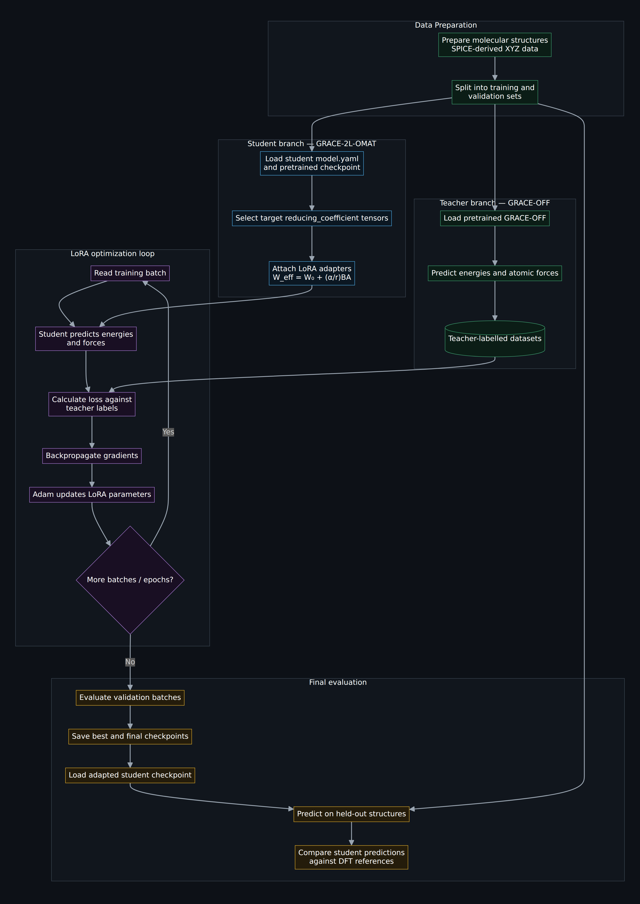
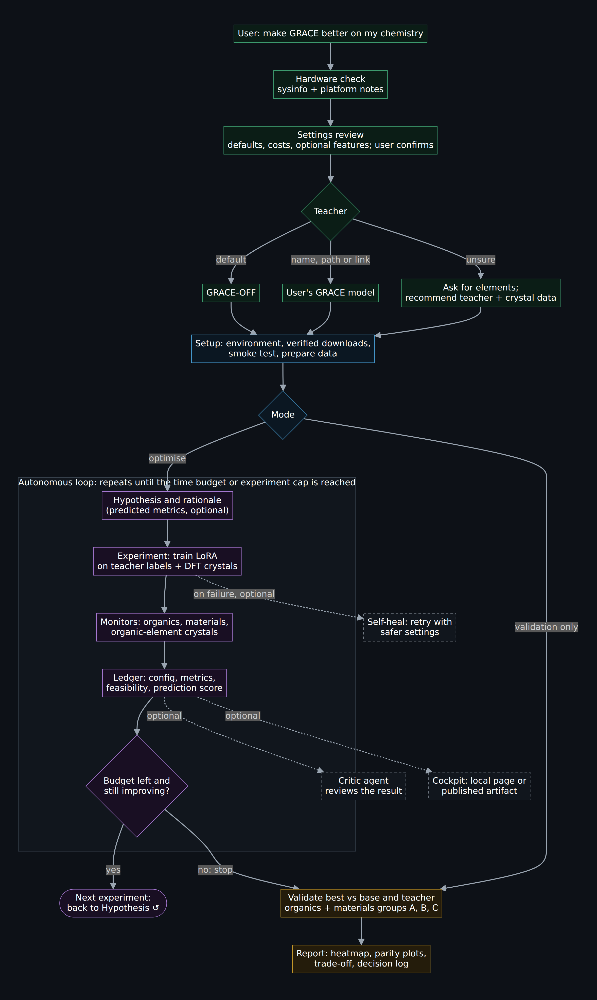

# grace-lora: specialise GRACE on a laptop with LoRA adapters, as a Claude Code skill

Adapt the **GRACE** foundation interatomic potential to a chemical domain where it is weak (organic
molecules by default) by training a small **LoRA adapter** on labels from a specialist teacher
model. It runs on an ordinary laptop CPU in about an hour, and **keeps** base GRACE's accuracy on
inorganic materials. The workflow is packaged as a **Claude Code skill**: an agent sets up the
machine, checks feasibility, runs an autonomous experiment loop, validates and writes a report.


https://github.com/user-attachments/assets/bd952034-eed4-4b4f-b0b5-b3dbd648cfc8


## Why?
Machine-learned interatomic potentials come in two kinds, and each fails where the other
succeeds:
- **Foundation models** (base GRACE: 89 elements, millions of materials calculations) are good
  across inorganic materials but poor in domains their data barely covered. On organic molecules
  GRACE's force error is ~303 meV/Å.
- **Specialist models** (GRACE-OFF, trained from scratch on ~2M high-level DFT calculations) are
  excellent in their domain (15 meV/Å on organics) but blind outside it. GRACE-OFF can run on
  only 1.7% of materials, and produces huge errors on many of those.
- **Building a specialist** costs millions of DFT calculations and GPU-days.
- **Fine-tuning a foundation model naively** makes it forget: it gets worse on everything that
  shares the retrained elements.

This project specialises the foundation model cheaply, using labels that already exist (a teacher
model, or DFT data), and avoids forgetting through **replay**: DFT materials data mixed into
training. The adapter is 5 MB; the base model stays untouched.

## Results (proof of concept)
Laptop: Intel i7-13650HX, WSL2, 11.7 GB RAM, CPU only. Force MAE vs DFT in meV/Å; lower is better.
The adapter trains only the 10 **organic elements** (H C N O F P S Cl Br I, the elements
GRACE-OFF covers). The columns are:
- **A: no organic elements:** materials the adapter never touches (metals, alloys, silicon…).
- **B: organic + other elements:** materials that mix both (oxides, nitrides, halides…).
- **C: only organic elements:** crystals made entirely of them (molecular crystals, P and S
  solids…).
- **All materials:** A, B and C weighted by their share of the MPtrj validation shard
  (24% / 74% / 1.7%).
- **Organic molecules:** 300 held-out SPICE molecules, GRACE-OFF's domain.

| Model | A: no organic elements | B: organic + other elements | C: only organic elements | **All materials** | **Organic molecules** |
|---|---|---|---|---|---|
| base (GRACE-2L-OMAT-medium-ft-AM) | 29 | 50 | 86 | **46** | 303 |
| smoke test (LoRA, organics only, no replay) | 29 | 125 | 302 | 105 | 108 |
| L1 (LoRA + replay, 500 + 500) | 29 | 59 | 148 | 54 | 106 |
| **L2 (LoRA + replay, 1000 + 600)** | **29** | **56** | **124** | **51** | **97** |
| GRACE-OFF (teacher) | | | | | **15** |

Model names used throughout: **base** = untrained GRACE; **smoke test** = LoRA on molecules
only; **C10 / C11** = epochs 10 and 11 of the same no-replay setup run longer; **L1 / L2** = the
first and second replay runs.

**L2:**
- **Data:** 1,000 GRACE-OFF-labelled molecules + 600 DFT materials (170 made only of adapted
  elements); rank 8, 10 epochs.
- **Size:** 1.36M trainable parameters (6.4%); a 5.4 MB adapter.
- **Time:** ~55 min of CPU training.
- **Accuracy:** organics 3.1× better than base (R² 0.82 → 0.97; 72% of the gap to the teacher
  closed), while all materials stay within 11% of base. Materials without adapted elements are
  predicted **identically** to base, by construction.

**Limitations:**
- About 6× less accurate than the teacher on organics.
- Crystals made only of adapted elements (molecular crystals, C/P/S solids) remain ~1.4× base.
  The same element weights must serve two DFT methods (ωB97M for the molecules, PBE for the
  materials).

## Tested scope
- **Tested:** only one combination, both GRACE: student `GRACE-2L-OMAT-medium-ft-AM` and
  teacher `GRACE-OFF-2L-medium` (organic molecules), on a CPU-only laptop (WSL2, 11.7 GB RAM).
  All results above come from it.
- **Supported but untested:** other GRACE teachers or students (other GRACE-OFF variants,
  `grace:<foundation model>`, your own GRACE SavedModels). The skill says so, runs the smoke test
  first and treats results with caution.
- **Not supported:** non-GRACE models (MACE, NequIP, other PyTorch/JAX models). Use a
  GRACE-format teacher or DFT labels instead.

## How it works
**Training pipeline:**



**The skill: agentic optimisation.** (Mermaid source in `docs/workflows.md`.)



- **LoRA is exact,** applied on the merged weights. The gradients of A and B come from
  tensorpotential's gradient of W by the chain rule, so GRACE's code is unchanged and the model
  stays equivariant.
- **Every experiment** records its configuration, monitor errors and **the agent's rationale** in
  a ledger, which becomes the report's decision log.
- **A feasibility check** uses base GRACE's built-in extrapolation grade γ to tell, before any
  training, whether a domain is reachable by an adapter.

## Install
Requirements:
- Linux, WSL2 or Apple Silicon macOS;
- Python 3.10–3.12, ~8 GB disk, ≥ 8 GB RAM;
- internet access.

```bash
git clone https://github.com/letuseatlettuce/GRACE-LoRA.git grace-lora && cd grace-lora
python3 pipeline.py sysinfo        # hardware check + recommendations
python3 pipeline.py setup-env      # creates .venv and installs TensorFlow 2.19 + tensorpotential (several GB)
```

## Works with any coding agent
The skill is plain Markdown instructions plus Python command-line tools, so any agent that can
read files and run shell commands can use it (Codex, Cursor, Gemini CLI, Aider, OpenHands,
local models with tool use). Claude Code discovers it automatically from `.claude/skills/`;
other agents start from [`AGENTS.md`](AGENTS.md). The only Claude-Code-specific piece is the
optional `critic` feature (it launches a reviewer subagent; it is off by default).

## Quick start with Claude Code (recommended)
Open the repository in Claude Code and ask, for example:

> adapt GRACE to organic molecules on my laptop

The `grace-lora` skill (`.claude/skills/grace-lora/`) takes over:
1. checks the system;
2. asks about student, teacher and data;
3. downloads models and data;
4. checks feasibility;
5. runs a smoke test with a time estimate;
6. runs the autonomous experiment loop within your time budget;
7. validates the best adapter and writes the report.

It asks before large downloads and long runs.

**Settings review first:** before any work, the skill shows the settings panel
(`python3 pipeline.py settings`): models, replay sizes, rank, epochs, objective, time budget,
validation and agent features (all off). It explains any setting you ask about, applies your
changes, and starts only after you confirm (`settings --confirm`). Details:
`.claude/skills/grace-lora/references/settings.md`, which includes quick recipes (faster POC,
overnight best quality, low RAM, minimal tokens, materials-safe, organics-max).

**Just evaluate models (no training):** ask, for example, "compare base GRACE, GRACE-OFF and my
checkpoint C11 in ./checkpoint_11". The skill runs `python3 pipeline.py validate-models --model
NAME=PATH ...`. PATH may be a SavedModel, a run folder, an adapter folder or a raw checkpoint.
You get organic and materials errors, a heatmap, parity plots and a verdict per model in
`<workdir>/validation/adhoc_<timestamp>/`. `--quick` takes ~5 min.

**Stopping the optimisation loop:** say "stop" at any time. The current experiment is killed,
everything finished stays in the ledger, you can validate any finished experiment, and the loop
resumes later from the ledger.

**Choosing a teacher:** by default the teacher is GRACE-OFF-2L-medium (organic molecules; the
tested setup). You can instead give:
- another model name (a GRACE-OFF variant, or `grace:<foundation model>`);
- a local GRACE `saved_model` folder;
- a GitHub, data-repository or publication link (for a paper, the agent finds the code/data
  link);
- or just the elements and the application you care about, and the agent recommends a teacher
  and the matching replay data.

Only GRACE-format teachers work. See `.claude/skills/grace-lora/references/choosing-a-teacher.md`.

## Optional agent features (everything off by default)
Without extra settings, the skill runs everything in **one agent** with **no subagents**. That
keeps token usage modest for users with limited plans. If you want more, switch features on
explicitly (`python3 pipeline.py options` shows the state):
- **`critic`**: a sceptical reviewer agent checks each experiment (noise, overfitting, whether
  the next move is justified). It requires `subagents`.
- **`self_heal`**: failed experiments are retried automatically (OOM → smaller batch, Metal/XLA
  → CPU, NaN → lower learning rate; at most 2 retries).
- **`predictions`**: once 2 experiments are done, the agent states a hypothesis and predicts the
  metrics before each run. The report compares predicted and actual.
- **`cockpit`**: a live, self-refreshing HTML dashboard (`<workdir>/report/cockpit.html`).
- **`cockpit_publish`** (Claude Code only): after each experiment the agent republishes the
  cockpit to one private claude.ai artifact link, to follow the loop from any browser or phone.
- **`subagents`** + `max_subagents` (default 3): the master switch and cap for any agent the
  skill may launch.

```bash
python3 pipeline.py options --enable critic subagents predictions   # example
python3 pipeline.py options --set max_subagents=2
```
Details: `.claude/skills/grace-lora/references/agent-options.md`.

## Manual usage
```bash
python3 pipeline.py settings            # review; change with --set KEY=VALUE; then --confirm
python3 pipeline.py configure --student GRACE-2L-OMAT-medium-ft-AM --teacher GRACE-OFF-2L-medium --data spice --yes
python3 pipeline.py fetch && python3 pipeline.py validate
python3 pipeline.py prepare                      # organic pool, MPtrj shards, monitor sets
python3 pipeline.py smoke                        # ~10-15 min sanity check + timings
python3 pipeline.py experiment --set n_organic=1000 --set n_materials=600 --set n_only_adapted=170 \
    --rationale "L2 configuration"
python3 pipeline.py ledger
python3 pipeline.py validate-exp --exp base && python3 pipeline.py validate-exp --exp best
python3 pipeline.py report                       # -> <workdir>/report/report.md
# validation only, no loop:
python3 pipeline.py validate-models --model mine=path/to/run_or_checkpoint [--quick]
```
The full command reference is in `.claude/skills/grace-lora/references/commands.md`; known errors
and fixes are in `references/troubleshooting.md`.

**Using a trained model:** `<workdir>/experiments/<id>/run/saved_model` loads with
`tensorpotential.calculator.TPCalculator(model=...)`. The adapter alone (`adapter.json` +
`best_trainable_state.npz`) is rebuilt on any machine with
`scripts/apply_adapter.py <run_dir> --out <dir>`.

## Data integrity and safety
- **Downloads are verified.** Every file the pipeline downloads (SPICE subsets, MPtrj shards,
  the default student and the GRACE-OFF teacher) has a pinned SHA-256 in `scripts/checksums.py`;
  a file whose content differs is rejected. MPtrj is fetched at a pinned Hugging Face revision.
  Set `GRACE_LORA_SKIP_CHECKSUMS=1` only after checking an intentionally updated source.
- **Pickled datasets get an integrity check.** Every `.pkl.gz` the pipeline writes gets a
  `.sha256` sidecar, and loading refuses a file whose sidecar is missing or does not match. This
  catches corrupted or modified files; it does not prove where a file came from, since anyone can
  supply both files. Unpickling can run code, so only load datasets from trusted sources. For a
  dataset you made yourself: `python scripts/config.py trust FILE`.

## Repository layout
```
pipeline.py                     stdlib-only orchestrator (setup, prepare, experiment, ledger, validate-exp, report)
requirements.txt
scripts/
  lora.py, train_lora.py        LoRA adapter + training (monitors, replay flags)
  make_dataset.py               teacher labelling
  make_replay_dataset.py        organic + materials replay mix
  fetch_materials.py            MPtrj shards
  experiment.py, ledger.py      one experiment / the experiment ledger
  validate_model.py             organic validation
  validate_materials.py         materials validation (groups A/B/C)
  domain_distance.py            feasibility via the extrapolation grade
  teacher_tools.py              resolve / check / recommend teachers
  report.py, plot_*.py          report and figures
  checksums.py                  pinned SHA-256s of all downloads
  apply_adapter.py, export_checkpoint.py, check_models.py, inspect_setup.py, config.py
tests/                          unit and end-to-end tests; tests/fixtures/ holds small sample data
.claude/skills/grace-lora/      the Claude Code skill (SKILL.md + references/)
docs/                           design notes and workflow charts
```

## Licences
- **This repository:** MIT (see `LICENSE`).
- **No full datasets or model weights are included** (only small extracts under `tests/fixtures/`
  for the tests); they are downloaded at run time from their sources, under their own terms:
  - GRACE foundation models (ICAMS, Ruhr-Universität Bochum): Academic Software License;
  - GRACE-OFF models (heid-lab/grace-off): MIT;
  - SPICE v2 subsets from Zenodo record 18662355: CC-BY 4.0;
  - MPtrj (Materials Project trajectories; Hugging Face copy `nimashoghi/mptrj`): CC-BY 4.0.

## Acknowledgements and citations
- Y. Lysogorskiy, A. Bochkarev, R. Drautz, *Graph atomic cluster expansion for foundational
  machine learning interatomic potentials*, npj Comput. Mater. (2026); arXiv:2508.17936.
- *GRACE-OFF: A Machine-Learned Interatomic Potential for Organic Liquids Using the GRACE
  Architecture*, J. Chem. Theory Comput. (2026), doi:10.1021/acs.jctc.6c01169.
- P. Eastman et al., *SPICE, a dataset of drug-like molecules and peptides for training machine
  learning potentials*, Sci. Data (2023).
- B. Deng et al., *CHGNet as a pretrained universal neural network potential for charge-informed
  atomistic modelling* (MPtrj dataset), Nat. Mach. Intell. (2023).
- E. J. Hu et al., *LoRA: Low-Rank Adaptation of Large Language Models*, arXiv:2106.09685 (2021).
