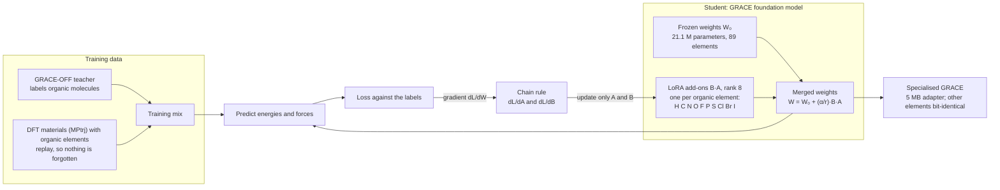
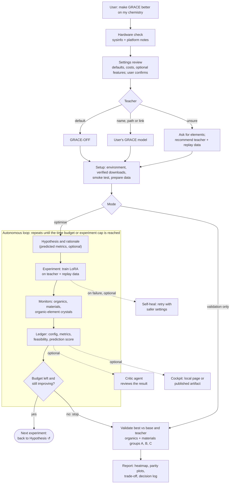

# Workflows

## GRACE LoRA: working principle
GRACE stays frozen. For each organic element, a low-rank add-on B·A is added to the 12
`reducing_` coefficient tensors (I1, I2, rho). Training data mixes teacher-labelled molecules
with DFT materials (replay), so the add-ons learn molecules without forgetting materials.

## The skill: agentic optimisation
The agent reviews settings with the user, picks a teacher, sets up, then runs experiments in a
loop: a hypothesis, a training run, monitor checks, a ledger entry and a decision, until the
budget runs out or progress stops. Then it validates the best model and writes the report.
Optional features (dashed or marked optional) are off by default.

